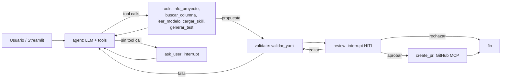

# dbt Test Agent

## 1. Nombre del proyecto

**dbt Test Agent**: agente que traduce pedidos en lenguaje natural a tests de dbt y abre una Pull Request en GitHub.

## 2. Integrantes

- Diego Rojas

## 3. Problema

Agregar un test de calidad de datos en dbt exige ubicar el modelo y la columna, elegir el `schema.yml` correcto, respetar la sintaxis de la versión de dbt y abrir una PR. Es repetitivo y propenso a errores.

## 4. Usuario / destinatario

Analytics engineers y equipos de datos que mantienen un proyecto dbt (en este caso sobre Databricks) en GitHub.

## 5. Descripción

Ejemplo: *"agrega un test que valide que `amount` en `sales` sea > 0 y < 100000"*.

Flujo principal:
1. El LLM interpreta el pedido y decide qué tool usar: carga la skill `dbt-testing` y explora con `info_proyecto`, `buscar_columna` y `leer_modelo`.
2. Si falta un dato o la columna está en varios modelos, **pregunta al usuario**.
3. `generar_test` produce el YAML nuevo y el diff (no escribe archivos).
4. El sistema valida (`validar_yaml`: sintaxis, estructura y `dbt parse` offline).
5. **Toda propuesta pasa por aprobación humana** (aprobar, editar o rechazar) con `interrupt()`.
6. Si se aprueba: rama nueva, commit y PR vía GitHub MCP. Nunca se escribe en `main`.

El LLM no puede validar ni crear PRs: esas acciones las ejecuta el grafo.

## 6. Arquitectura

Diagrama completo y tabla de componentes en [docs/arquitectura/arquitectura.md](docs/arquitectura/arquitectura.md).



- **LLM:** Gemini por defecto, OpenAI opcional (`LLM_PROVIDER`).
- **Tools:** `src/tools/dbt/` (metadata, lectura, generación y validación), `src/tools/github/` (MCP y PR), más `src/tools/common.py` y `src/tools/skills.py`. Las tools devuelven `{ok, data, error}`.
- **Skill:** `src/skills/dbt-testing/` (`SKILL.md` + catálogo de tests + sintaxis), cargada como tool en 3 niveles.
- **Estado/memoria:** checkpointer SQLite (`SQLITE_PATH`); cada conversación es un `thread_id` reanudable.
- **HITL:** `interrupt()` en `ask_user` (preguntas) y `review` (aprobación).
- **Integración externa:** GitHub MCP (`get_file_contents`, `create_branch`, `push_files`, `create_pull_request`).
- **Trazabilidad:** cada paso registra herramienta, éxito, código de error y latencia (`trace` en el estado).

## 7. Decisiones técnicas

- **Agente único, sin RAG:** el proyecto dbt es estructurado y se consulta por manifest; RAG no aporta valor.
- **El agente no se conecta al warehouse:** trabaja sobre archivos y manifest; la validación usa `dbt parse` con un profile dummy (`ci/profiles.yml`).
- **dbt 2.x (binario):** el proyecto corre con dbt 2.0.8 (manifest v12). Usa `data_tests:` con `arguments:`. No hay paquete Python de dbt-core/dbt-databricks que instalar.
- **Contrato de tools:** todas devuelven `{ok, data, error}` con entradas validadas con pydantic.
- **Manifest versionado:** `dbt/target/` no se ignora para facilitar la lectura remota; se puede revisar más adelante.
- **Solo tests de `dbt_utils`, `dbt_expectations` y nativos:** el agente nunca escribe SQL ni macros. Si el test no está en esos paquetes, pide una macro existente o cancela (evita alucinaciones).
- **Aprobación humana obligatoria** antes de cualquier PR, con diff y resultado de validación.
- **`push_files`** (un solo commit, sin `sha`) en vez de `create_or_update_file`; antes de subir se verifica que el archivo en la base no cambió.
- **Persistencia:** SQLite con `SqliteSaver`; permite reanudar tras reiniciar.
- **Modelo:** Gemini por defecto (`gemini-2.5-flash`), OpenAI soportado; ambos con `temperature=0`.

## 8. Instalación

Requisitos: Python 3.11+. `requirements.txt` incluye `dbt==2.0.8` (dbt v2, instalado con pip), necesario para `dbt parse`. Si ya tenés el binario `dbt` 2.x en el `PATH`, se usa ese.

```bash
python3.11 -m venv .venv
source .venv/bin/activate
pip install -r requirements.txt
```

## 9. Configuración

```bash
cp .env.example .env   # completar GITHUB_TOKEN, GITHUB_REPO, LLM_*
```

| Variable | Descripción |
|---|---|
| `LLM_PROVIDER`, `LLM_MODEL`, `LLM_API_KEY` | LLM configurable |
| `GITHUB_TOKEN` | Token fine-grained, un solo repo, permisos mínimos (contenido y PRs) |
| `GITHUB_REPO` | `owner/repo` destino de las PRs |
| `BASE_BRANCH` | Rama base (`main`) |
| `GITHUB_MCP_URL` | URL del GitHub MCP Server remoto |
| `DBT_PROJECT_DIR`, `DBT_MANIFEST_PATH`, `DBT_PROFILES_DIR` | Proyecto dbt, manifest y profile dummy |
| `SQLITE_PATH` | Base del checkpointer |

Nunca versionar `.env`.

## 10. Ejecución

```bash
python scripts/refresh_manifest.py     # regenera el manifest sin conexión
python scripts/list_mcp_tools.py        # lista las tools del GitHub MCP
streamlit run src/ui/app.py             # interfaz
```

Con Docker (instala los paquetes dbt, regenera el manifest y levanta la UI en http://localhost:8501):

```bash
cp .env.example .env   # completar variables
docker compose up --build
```

La base SQLite se guarda en el volumen `agent-data`.

## 11. Uso

1. Abrir la interfaz y escribir: *"agregá un test que valide que subtotal en stg_orders sea > 0 y < 100000"*.
2. El agente explora, propone `dbt_utils.accepted_range` y muestra el diff validado.
3. Aprobar, editar el YAML o rechazar. Al aprobar se abre la PR y se muestra el enlace.

TODO: captura/video de la demo.

## 12. Evaluación

Tests de tools, grafo (LLM y GitHub mockeados), persistencia SQLite y UI (`AppTest`):

```bash
python -m pytest                    # todo
python -m pytest -m "not integration"
```

Dataset de 20 casos en `evals/dataset/casos.jsonl`: rangos, tests nativos, relaciones, anomalías, tests entre columnas, ambigüedad, datos faltantes, modelo/columna inexistente, test no soportado, macro inexistente, pedido fuera de alcance, intento de inyección y rechazo humano.

```bash
python -m evals.run_eval --dry-run          # valida el dataset contra el manifest (sin LLM)
python -m evals.run_eval                    # corre los casos con el LLM configurado
python -m evals.run_eval --ids c01 c05      # casos puntuales
```

Cada caso usa un usuario simulado (respuestas a preguntas y decisión de aprobación) y un GitHub falso que registra las llamadas: **no se abren PRs reales**. `dbt parse` sí corre de verdad.

Métricas: `task_success` (resultado esperado, test/modelo/columna/argumentos correctos y ninguna escritura antes de aprobar), `tool_selection` (recall de tools esperadas; 0 si usa una prohibida), pasos del LLM, errores de tool, latencia (promedio y p95) y `pr_antes_de_aprobar` (debe ser 0).

Resultados en `evals/resultados/` (`ultimo.md` y un JSON por corrida).

TODO: ejecutar la evaluación con el LLM real y pegar aquí la tabla de resultados.

## 13. Limitaciones

- No inspecciona datos del warehouse (mejora futura): los valores y umbrales los da el usuario.
- `generar_test` cubre 15 tests del catálogo; ampliar es editar `test-catalog.yml`.
- `ruamel.yaml` puede reformatear mapas en una línea de archivos existentes; el diff lo muestra antes de la PR.
- La verificación de la base asume que `get_file_contents` devuelve el texto del archivo; confirmar con el servidor real.
- `buscar_columna` busca columnas declaradas en la metadata del manifest; no inspecciona SQL.
- Se asume que el manifest local está actualizado y se regenera fuera del agente cuando corresponde.
- No se mide costo/tokens en la evaluación.
- Docker verificado construyendo la imagen y levantando la UI; la corrida completa con LLM y GitHub reales depende de tus credenciales.
