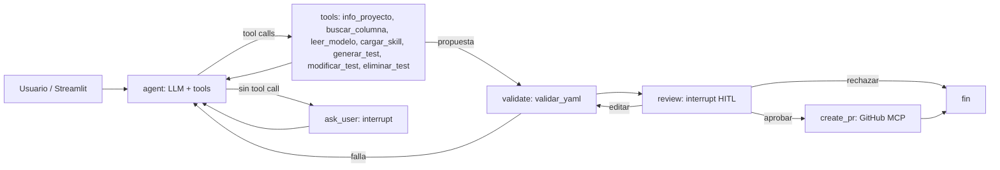
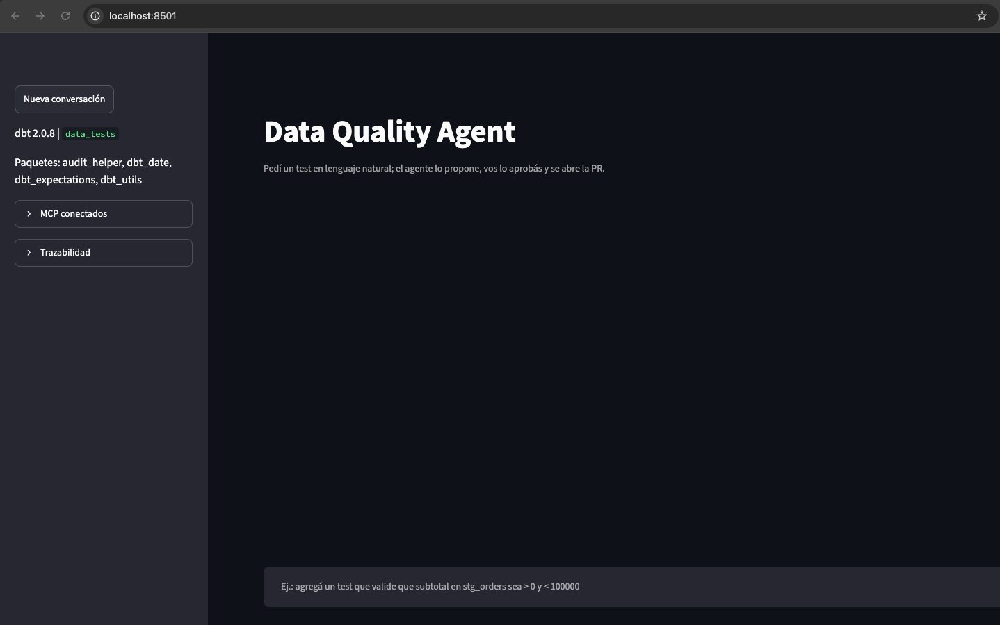

# Data Quality Agent

## 1. Nombre del proyecto

**Data Quality Agent**: agente que traduce pedidos de data tests en lenguaje natural a tests de dbt y abre una Pull Request en GitHub.

## 2. Integrantes

- Diego Rojas

## 3. Problema

Agregar, modificar o eliminar un test de calidad de datos en dbt exige ubicar el modelo y la columna, elegir el `schema.yml` correcto, respetar la sintaxis de la versión de dbt y abrir una PR usando Git. Esto hace que el proceso sea repetitivo y propenso a errores, sobre todo para personas no técnicas.

## 4. Usuario / destinatario

Cualquier analista que interactúe con los datos y tenga permisos en el repositorio dbt de GitHub.

## 5. Ejemplos de Uso Real

Ejemplos: *"agrega un test que valide que `amount` en `sales` sea > 0 y < 100000"*, *"cambiá a warn la severity del not_null de `orders.order_id`"*, *"removemos el accepted_values de `customers.customer_type`"*. Cada pedido cambia un solo test y abre una sola PR.

Flujo de funcionamiento:
1. El LLM interpreta el pedido y decide qué tool usar: carga la skill `dbt-testing` y explora con `info_proyecto`, `buscar_columna` y `leer_modelo`.
2. Si falta un dato o la columna está en varios modelos, **pregunta al usuario cuál usar**.
3. Prepara la propuesta de cambio YAML con la tool correspondiente: `generar_test`, `modificar_test` o `eliminar_test`.
4. Valida la propuesta con `validar_yaml` (sintaxis, estructura y `dbt parse` offline).
5. **Human-in-the-loop:** el usuario aprueba, edita o rechaza el cambio.
6. Si se aprueba, crea una rama, hace un commit y abre una PR mediante GitHub MCP.

## 6. Arquitectura

Diagrama completo y tabla de componentes en [docs/arquitectura/arquitectura.md](docs/arquitectura/arquitectura.md).



- **LLM:** usa OpenAI por default.
- **Tools:** las tools locales de `src/tools/dbt/` devuelven `{ok, data, error}`. GitHub se integra por MCP; sus respuestas dependen del servidor remoto.
- **Skill:** `src/skills/dbt-testing/` (`SKILL.md` + catálogo de tests + sintaxis), cargada como tool en 3 niveles.
- **Estado/memoria:** checkpointer SQLite (`SQLITE_PATH`); cada conversación es un `thread_id` reanudable.
- **HITL:** `interrupt()` en `ask_user` (preguntas) y `review` (aprobación).
- **Integración externa:** GitHub MCP (`get_file_contents`, `create_branch`, `push_files`, `create_pull_request`).
- **Trazabilidad:** el resumen por paso se conserva en el estado (`trace`) y el detalle de entradas/salidas se persiste en `tool_traces` dentro del SQLite configurado por `SQLITE_PATH`.

## 7. Decisiones técnicas

- **Agente único, sin RAG:** el proyecto dbt es estructurado y se consulta por manifest; RAG no aporta valor.
- **El agente no se conecta al warehouse:** trabaja sobre archivos y manifest; la validación usa `dbt parse` con un profile dummy (`ci/profiles.yml`).
- **Contrato de tools:** devuelven `{ok, data, error}` y validan las entradas con Pydantic.
- **Manifest vive en el repo:** Para simplificar se deja servido el manifest en el repo de donde se lee la metadata del proyecto de dbt. Lo ideal es que esta metadata siempre este actualizada cada vez que se va a interactuar con el agente y la traiga de un s3, por ejemplo.
- **Solo tests de `dbt_utils`, `dbt_expectations` y nativos:** el agente nunca escribe SQL ni macros. Si el test que pide el usuario no está en esos paquetes, pide una macro existente o cancela.
- **Aprobación humana obligatoria** antes de cualquier PR, con diff y resultado de validación.
- **Persistencia:** SQLite con `SqliteSaver`; permite reanudar tras reiniciar.

## 8. Ejecución del agente

Cloná el repositorio y ejecutá estos comandos desde su carpeta:

```bash
git clone https://github.com/diegorojasucv/tf-ai-agent.git
cd tf-ai-agent
python3.11 -m venv .venv
source .venv/bin/activate
pip install -r requirements.txt
```

Copiar archivo de credenciales:
```bash
cp .env.example .env
```

En `.env`, solo hay que completar el `LLM_API_KEY` y `GITHUB_TOKEN`. Mandar un correo a `darb302@gmail.com` pidiendo estos tokens.

Desde la raíz del repositorio, con Docker:
```bash
docker compose up --build
```

Sin Docker, activá el entorno virtual creado en el paso 8 y ejecutá desde la raíz del repositorio:
```bash
streamlit run src/ui/app.py
```

Abrí **http://localhost:8501** para usar el agente. La interfaz se verá similar a esta imagen:



En la barra lateral podés consultar el estado de GitHub MCP y un resumen de trazabilidad. El botón **Ver entradas y salidas** abre el detalle de las invocaciones de la conversación.

Prompt de ejemplo para probar el agente: *"Agregá un test que valide que subtotal en stg_orders sea > 0 y < 100000"*.

TODO: captura/video de la demo.

## 9. Evaluación

Tests de tools, grafo (LLM y GitHub mockeados), persistencia SQLite y UI (`AppTest`):

```bash
python -m pytest                    # todo
python -m pytest -m "not integration"
```

Dataset de 22 casos en `evals/dataset/casos.jsonl`: rangos, tests nativos, relaciones, anomalías, tests entre columnas, eliminación y modificación de tests, ambigüedad, datos faltantes, modelo/columna inexistente, test no soportado, macro inexistente, pedido fuera de alcance, intento de inyección y rechazo humano.

```bash
python -m evals.run_eval --dry-run          # valida el dataset contra el manifest (sin LLM)
python -m evals.run_eval                    # corre los casos con el LLM configurado
python -m evals.run_eval --ids c01 c05      # casos puntuales
```

Cada caso usa un usuario simulado (respuestas a preguntas y decisión de aprobación) y un GitHub falso que registra las llamadas: **no se abren PRs reales**. La validación ejecuta `dbt parse` de verdad, pero con el perfil dummy y sin conexión al warehouse.

Métricas: `task_success` (resultado esperado, campos esperados de la propuesta y ninguna PR antes de aprobar), `tool_selection` (recall de tools esperadas; 0 si usa una prohibida), pasos del LLM, errores de tool, latencia (promedio y p95) y `pr_antes_de_aprobar` (debe ser 0).

Resultados en `evals/resultados/` (`ultimo.md` y un JSON por corrida).

TODO: ejecutar la evaluación con el LLM real y pegar aquí la tabla de resultados.

## 10. Monitoring

El agente persiste en el SQLite definido por `SQLITE_PATH` (por defecto `data/agent.db`) tanto el estado necesario para reanudar conversaciones como las trazas de uso. Las tablas principales son:

- `checkpoints`: estado guardado de cada conversación (`thread_id`), para poder reanudarla.
- `writes`: actualizaciones intermedias del estado, administradas por LangGraph.
- `tool_traces`: registro de operaciones instrumentadas: tool/nodo, fecha, resultado, duración, error, entradas/salidas y tokens cuando están disponibles.

Ejemplo para consultar el resultado y la duración de las invocaciones de una conversación:

```sql
SELECT timestamp, name, ok, duration_ms, error_code
FROM tool_traces
WHERE thread_id = '<thread_id>'
ORDER BY id;
```

## 11. Limitaciones

- No inspecciona datos del warehouse (mejora futura): los valores y umbrales los da el usuario.
- Usa solo tests nativos y de los paquetes dbt admitidos, por lo que no cubre tests personalizados de mayor complejidad.
- Se asume que el manifest local siempre está actualizado.
