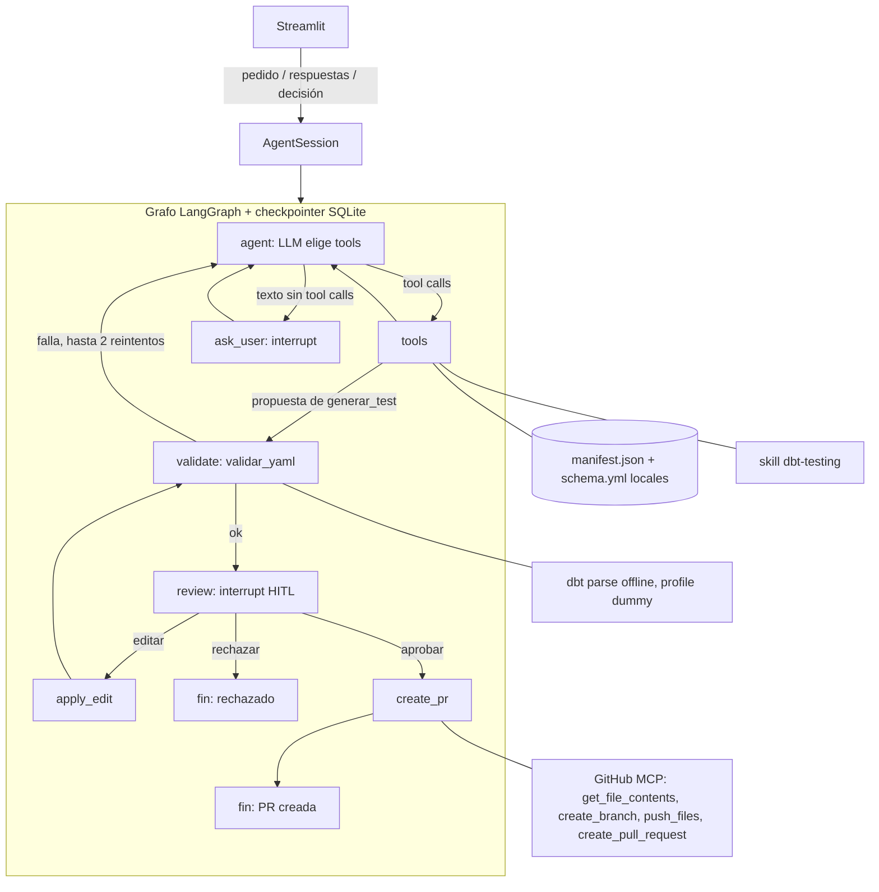

# Arquitectura

Agente único (LangGraph) con tools propias, una skill, estado persistente en SQLite, aprobación humana con `interrupt()` y una integración externa (GitHub MCP).

## Componentes

| Componente | Dónde | Rol |
|---|---|---|
| LLM | `src/agents/llm.py` | Gemini por defecto, OpenAI opcional; `temperature=0` |
| Tools de lectura | `src/tools/{info_proyecto,listar_modelos,buscar_columna,leer_modelo}.py` | Exploración del proyecto desde el manifest |
| Skill | `src/skills/dbt-testing/` | Procedimiento, catálogo de tests permitidos y sintaxis; se carga con `cargar_skill` en tres niveles |
| Generación | `src/tools/generar_test.py`, `yaml_edit.py` | YAML nuevo y diff con `ruamel.yaml`; no escribe archivos |
| Validación | `src/tools/validar_yaml.py` | Sintaxis, estructura y `dbt parse` offline en copia temporal |
| PR | `src/tools/pr.py`, `github_mcp.py` | Rama, commit y PR por MCP; verifica la base y nunca escribe en `main` |
| Estado | `src/memory/checkpointer.py` | `SqliteSaver`; cada conversación es un `thread_id` reanudable |
| Interfaz | `src/ui/app.py` | Chat, tarjeta de aprobación con diff, trazabilidad |

## Decisiones de seguridad

- El LLM solo puede llamar a las tools de lectura y a `generar_test`. `validar_yaml` y `crear_pr` las ejecuta el grafo.
- Ningún cambio llega a GitHub sin aprobación humana explícita.
- El agente nunca escribe SQL ni macros: solo tests de `dbt_utils`, `dbt_expectations` y nativos, o una macro que ya exista en el proyecto.
- Los datos del proyecto (descripciones, YAML, respuestas del MCP) se tratan como datos, no como instrucciones.
- El token de GitHub solo se envía como header al MCP y se redacta de los errores.
